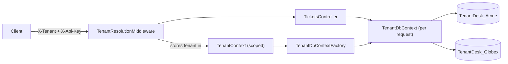

# TenantDesk Lite

A small **multi-tenant helpdesk (ticketing) API** built with **C#, ASP.NET Core and Entity Framework Core**.
Every customer (tenant) gets its **own database**, and one tenant can never read or change another tenant's tickets.

## Tech stack

| Area | Technology |
|---|---|
| Language / runtime | C#, .NET 10 (LTS) |
| Web | ASP.NET Core Web API (controllers, custom middleware, dependency injection) |
| Data | Entity Framework Core 10, Microsoft SQL Server (SQLite mode for zero-setup runs and tests) |
| Testing | xUnit, `WebApplicationFactory` integration tests |
| DevOps | Docker / Docker Compose, GitHub Actions CI |

## How tenant isolation works



1. **Tenant resolution** - `TenantResolutionMiddleware` reads the tenant from the `X-Tenant` header
   (or the first label of the host name, e.g. `acme.localhost`).
2. **Authentication** - the request must carry that tenant's `X-Api-Key` (compared in constant time).
   Unknown tenant and wrong key give the same `401`, so tenant names cannot be enumerated.
3. **Database per tenant** - `TenantDbContextFactory` creates a `TenantDbContext` that is connected to the
   resolved tenant's own database. The context is registered as a *scoped* service, one per request.
4. **Isolation by construction** - `TicketsController` never mentions a tenant. It only receives a
   `TenantDbContext` that already points at the right database, so there is no `WHERE TenantId = ...`
   that a developer could forget.
5. **Provisioning** - on start-up `TenantDatabaseInitializer` creates the database and schema of every
   configured tenant (with retries, because SQL Server in Docker needs a few seconds to boot).
6. **Observability** - every log line written while handling a request carries the `TenantId` in its log scope.

## Getting started

**Prerequisites:** [.NET 10 SDK](https://dotnet.microsoft.com/download). Docker is only needed for the SQL Server mode.

### Option A - SQL Server in Docker (the real setup)

```bash
docker compose up -d sqlserver          # wait ~30 s for SQL Server to boot
dotnet run --project src/TenantDesk.Api # http://localhost:5080
```

### Option B - SQLite, nothing to install

```bash
# macOS / Linux
Database__Provider=Sqlite dotnet run --project src/TenantDesk.Api

# Windows PowerShell
$env:Database__Provider = "Sqlite"; dotnet run --project src/TenantDesk.Api
```

The per-tenant database files are created in `./data`.

### Option C - everything in containers

```bash
docker compose up --build               # API on http://localhost:8080
```

## Try it

Demo tenants (from `appsettings.json`): `acme` / `acme-dev-key` and `globex` / `globex-dev-key`.

```bash
# Create a ticket for Acme
curl -X POST http://localhost:5080/api/tickets \
  -H "X-Tenant: acme" -H "X-Api-Key: acme-dev-key" -H "Content-Type: application/json" \
  -d '{"title":"Printer on 3rd floor is on fire","description":"Smoke everywhere","priority":"High"}'

# Acme sees it ...
curl http://localhost:5080/api/tickets -H "X-Tenant: acme" -H "X-Api-Key: acme-dev-key"

# ... Globex does not (empty list)
curl http://localhost:5080/api/tickets -H "X-Tenant: globex" -H "X-Api-Key: globex-dev-key"
```

More examples are in [`requests.http`](requests.http) (VS Code REST Client, Visual Studio, Rider).

## API

| Method | Route | Description |
|---|---|---|
| GET | `/health` | Health check (no tenant needed) |
| GET | `/api/tickets?status=Open` | List tickets of the current tenant, optional status filter |
| GET | `/api/tickets/{id}` | Get one ticket |
| POST | `/api/tickets` | Create a ticket (`title`, `description`, `priority`: Low / Medium / High) |
| PATCH | `/api/tickets/{id}/status` | Change status: Open, InProgress, Resolved, Closed |

Status codes: `400` missing tenant or invalid body, `401` unknown tenant / bad key,
`404` ticket not found (also for tickets that belong to another tenant), `409` invalid status change.

Business rule: a **closed ticket cannot be reopened** (`409 Conflict`).

## Tests

```bash
dotnet test
```

- **Unit tests** for the ticket domain rules (`TicketTests`).
- **Integration tests** that start the real API in memory (`TenantApiTests`), including:
  - a ticket created by one tenant is invisible to another tenant (list and by id),
  - every tenant gets its own database file,
  - missing tenant -> 400, unknown tenant / wrong key / another tenant's key -> 401,
  - tenant resolution from the sub-domain,
  - validation (400), filtering, `409` on reopening a closed ticket.

The tests use SQLite files in a temp folder, so they need neither Docker nor SQL Server (also in CI).

## Project layout

```
src/TenantDesk.Api
  Tenancy/       tenant model, tenant catalogue, per-request TenantContext, resolution middleware
  Data/          TenantDbContext, TenantDbContextFactory (database per tenant), start-up provisioning
  Domain/        Ticket entity with its business rules
  Contracts/     request / response models with validation
  Controllers/   TicketsController
tests/TenantDesk.Tests
.github/workflows/ci.yml   build + test on every push
```

## Design decisions and limitations

- **Database per tenant** gives the strongest isolation and per-tenant backup/restore, at the cost of more
  databases to manage. A shared-database design with a `TenantId` column and EF Core global query filters is the
  alternative for many small tenants.
- Tenants are read from `appsettings.json`. A production system would keep them in a catalogue database.
- Schema is created with `EnsureCreated()` to keep the demo simple. Production should use EF Core migrations
  applied to every tenant database.
- The API key is stored in plain configuration for demo purposes. Use a secret store in production.

## Possible next steps

- JWT authentication with the tenant id as a claim, plus roles (admin / agent)
- Tenant onboarding endpoint backed by a catalogue database, and EF Core migrations
- Vue.js front end
- Structured logging to Elasticsearch / Kibana (the `TenantId` log scope is already in place)
- BDD scenarios (Reqnroll / Gherkin) for the isolation rules
